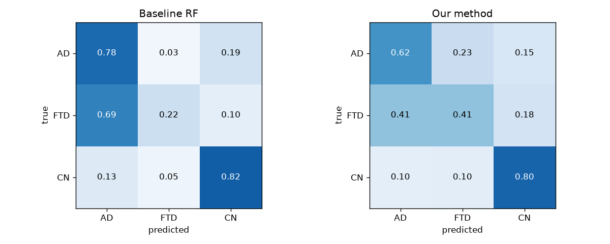
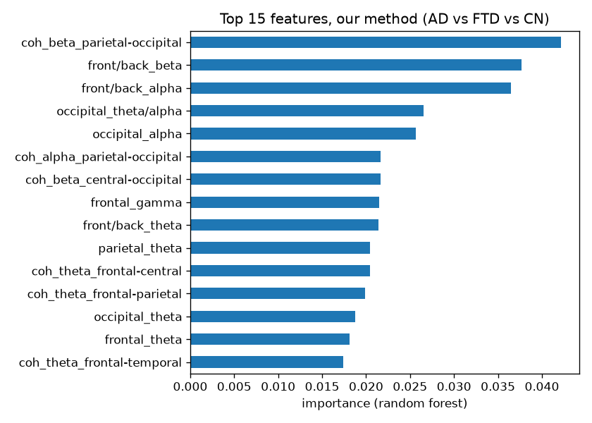
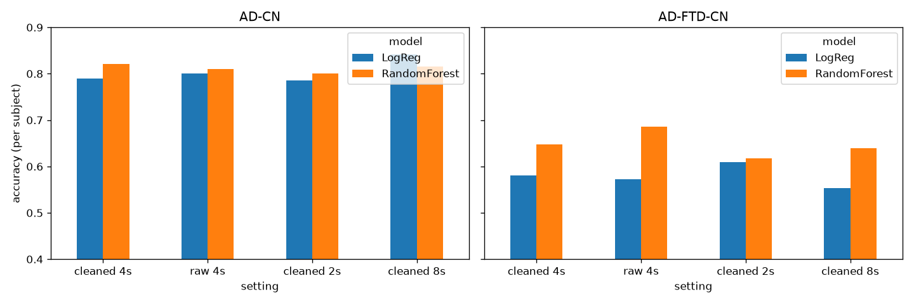
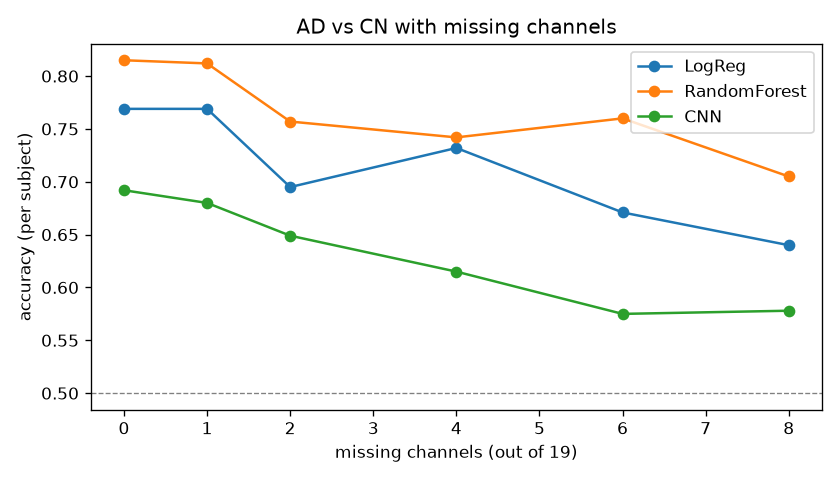
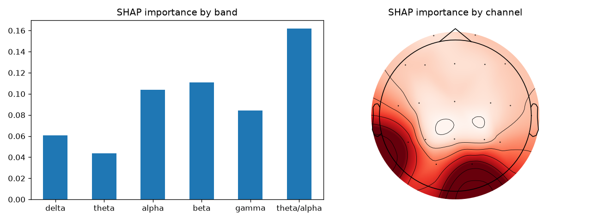

# neurotrace

**Telling Alzheimer's disease (AD), frontotemporal dementia (FTD) and healthy brains (CN) apart from a few minutes of resting-state EEG.**

neurotrace takes an eyes-closed EEG recording, turns it into frequency-band features, and predicts one of three groups. Along the way it asks four practical questions: does cleaning the signal help, what happens when electrodes are missing, *why* does the model decide what it decides, and can it run on small hardware?

> Course project (VIT), work in progress. This is a research prototype, **not a clinical tool**.

---

## Key results at a glance

| Question | Answer |
|---|---|
| How well can it separate AD from healthy? | **82 %** of subjects correct (random forest) |
| How well can it separate all three groups? | **64 %** accuracy, but FTD is the weak spot |
| Can FTD detection be improved? | Yes, **our method roughly doubles FTD recall** (22 % → 41 %) |
| Does signal cleaning (ICA) help? | Not noticeably for band-power features |
| What if electrodes are missing? | Random forest still gets **71 %** with 8 of 19 channels gone |
| What does the model look at? | Theta/alpha ratio over the back of the head, the classic AD "slowing" |
| Can it run on a small device? | Yes, a slimmed-down forest: **1.5 MB, 3 ms** per 4-second window |

All numbers are **per subject** and come from cross-validation where a person is never in both the training and the test set (more in [How it is evaluated](#how-it-is-evaluated)).

---

## Contents

- [The data](#the-data)
- [How it works](#how-it-works)
- [Our method: better FTD detection](#our-method-better-ftd-detection)
- [Other experiments](#other-experiments)
- [How it is evaluated](#how-it-is-evaluated)
- [Getting started](#getting-started)
- [Demo app](#demo-app)
- [Project structure](#project-structure)
- [Limitations](#limitations)

---

## The data

[OpenNeuro ds004504](https://openneuro.org/datasets/ds004504): eyes-closed resting EEG from **88 people** (36 AD, 23 FTD, 29 CN), 19 scalp electrodes (10-20 layout), 500 Hz, in BIDS format. It comes in two versions, which this project compares:

- **raw** recordings
- **cleaned** recordings (`derivatives/`, already filtered and cleaned with ICA / artifact removal)

The data is **not** in this repository; see [Getting started](#getting-started).

## How it works

```
EEG recording ──► cut into 4 s windows ──► power spectrum (1-45 Hz)
              ──► features per window  ──► classifier ──► average over windows ──► AD / FTD / CN
```

1. **Windows.** Each recording is cut into fixed-length windows ("epochs") of 2, 4 or 8 seconds.
2. **Spectrum.** For every window and channel, a Welch power spectrum from 1 to 45 Hz.
3. **Features.** The share of power in each band (delta 1-4, theta 4-8, alpha 8-13, beta 13-30, gamma 30-45 Hz) plus the theta/alpha ratio, for all 19 channels: 114 numbers per window.
4. **Models.** Logistic regression, random forest, and a small 1D CNN that reads the raw spectra directly.
5. **One answer per person.** The model scores every window; the person's prediction is the average.

## Our method: better FTD detection

The baseline models label most FTD patients as AD: they find only about **1 in 5** FTD subjects. Our method keeps the *same* random forest and changes only what it is given:

1. **One row per person** (median of each feature over their windows) instead of thousands of near-duplicate windows, so the model learns disease patterns rather than memorising individuals.
2. **Brain regions instead of channels.** 19 channels are averaged into 5 regions (frontal, central, temporal, parietal, occipital), which gives fewer features for only 88 people.
3. **Features aimed at FTD**, which mainly affects the *front* of the brain while AD affects the *back*:
   - peak alpha frequency (where the alpha peak sits; it slows with disease)
   - spectral entropy (how spread out the spectrum is)
   - front-vs-back power ratio in each band
   - coherence between regions (how strongly two regions move together)

### Where the mistakes go



The baseline sends **69 %** of FTD subjects to AD. Our method cuts that to **41 %** and correctly finds **41 %** of FTD subjects (up from 22 %). The trade-off: some AD subjects (23 %) are now called FTD, because AD is no longer the "safe default" answer.

### Step-by-step (ablation)

AD vs FTD vs CN, 10 shuffles (`results/our_method_ablation.csv`). Each row adds one change.

| Method | Accuracy | Macro F1 | FTD recall |
|---|---|---|---|
| Baseline: random forest on windows, channel band power | **0.644** | 0.588 | 0.217 |
| + one row per person | 0.551 | 0.530 | 0.335 |
| + regional features | 0.550 | 0.535 | 0.378 |
| + peak alpha, entropy, front/back ratios | 0.597 | 0.581 | **0.422** |
| **+ coherence (our method)** | 0.624 | **0.604** | 0.409 |
| Our method with a two-step classifier (healthy vs dementia, then AD vs FTD) | 0.599 | 0.566 | 0.322 |

Macro F1 averages over the three classes equally, so it rewards getting the small FTD group right; plain accuracy mostly rewards the larger AD and CN groups.

### On every task

`results/our_method_vs_baseline.csv`

| Task | Baseline F1 | Our F1 | Baseline FTD recall | Our FTD recall |
|---|---|---|---|---|
| AD vs FTD vs CN | 0.588 | **0.604** | 0.217 | **0.409** |
| AD vs FTD | 0.519 | **0.566** | 0.187 | **0.487** |
| FTD vs CN | 0.764 | **0.785** | 0.652 | **0.726** |
| AD vs CN | **0.820** | 0.783 | - | - |

**In short:** our method is better on every task that involves FTD. On plain AD vs CN the baseline is still better, so the two are complementary. The two-step classifier did not help.

### What our method relies on



The new features dominate: beta coherence between parietal and occipital regions, and the front-vs-back beta and alpha ratios.

## Other experiments

### Model comparison

Cleaned data, 4 s windows (`results/model_comparison.csv`).

| Task | Logistic regression | Random forest | 1D CNN |
|---|---|---|---|
| AD vs CN | 0.79 | **0.82** | 0.68 |
| AD vs FTD vs CN | 0.57 | **0.64** | 0.51 |

With only 88 people the CNN overfits and loses to the classical models.

### Preprocessing: raw vs cleaned, 2 / 4 / 8 s windows



All differences stay within about ±4 points, which is inside the shuffle-to-shuffle noise. Cleaning gives no clear gain for band-power features. Longer 8 s windows help logistic regression a little on AD vs CN (0.84). Details: `results/preprocessing_comparison.csv`.

### Missing electrodes



Models are trained on complete recordings. At test time, *k* random channels are removed and filled in with the average of the remaining ones (AD vs CN).

| Missing channels | 0 | 2 | 4 | 6 | 8 |
|---|---|---|---|---|---|
| Logistic regression | 0.77 | 0.70 | 0.73 | 0.67 | 0.64 |
| **Random forest** | **0.82** | **0.76** | **0.74** | **0.76** | **0.71** |
| 1D CNN | 0.69 | 0.65 | 0.62 | 0.58 | 0.58 |

The random forest degrades the most gracefully.

### Explainability



For the random forest (SHAP values), the **theta/alpha ratio** is the most important feature group, and the **occipital and left temporal-parietal** channels matter most. This matches the known slowing of the posterior alpha rhythm in Alzheimer's disease. A per-feature view is in `results/shap_summary.png`.

For the CNN (gradient × input saliency, `results/cnn_saliency.png`) the strongest inputs are O2 (back of the head) and Fp1 (above the left eye). Fp1 is the channel most affected by eye movements, so part of the CNN's signal may be artifact rather than brain activity.

### Running on small hardware

AD vs CN, single CPU core (`results/edge_benchmark.csv`). Time includes computing features from a raw 4 s window.

| Model | Accuracy | Size | Time per 4 s window |
|---|---|---|---|
| Logistic regression | 0.79 | 4 KB | 1.1 ms |
| Random forest (300 trees) | 0.82 | 57 MB | 14.8 ms |
| **Random forest (50 trees, depth 8)** | **0.80** | **1.5 MB** | **3.3 ms** |
| 1D CNN | 0.68 | 54 KB | 1.0 ms |

Every model runs far faster than real time. The small forest keeps almost all the accuracy at 1/38 of the size, which makes it the best fit for constrained devices.

## How it is evaluated

- **Subject-level splits.** 5-fold `StratifiedGroupKFold`: all windows of a person stay on the same side of the split, so the model is never tested on someone it has already seen. Without this, accuracy looks much higher than it really is.
- **Per-subject scores.** Window predictions are averaged into one prediction per person, and accuracy is the fraction of *people* classified correctly.
- **Repeated shuffles.** Each result is averaged over several random fold assignments (10 for most tables, 3 for the slower CNN and preprocessing runs) to smooth out luck in the split.
- **Balanced classes.** Models use class weighting so the smaller FTD group is not ignored.

## Getting started

### 1. Get the code

```bash
git clone https://github.com/TrialsInTime/neurotrace.git
cd neurotrace
python -m venv .venv
.venv\Scripts\activate          # Windows
# source .venv/bin/activate     # macOS / Linux
pip install -r requirements.txt
```

### 2. Get the data

Download [ds004504](https://openneuro.org/datasets/ds004504) and put it in a folder called `dataset/` **next to** the `neurotrace/` folder:

```
ML PROJECT/
├── dataset/
│   ├── participants.tsv
│   ├── sub-001/eeg/...        raw recordings
│   └── derivatives/
│       └── sub-001/eeg/...    cleaned recordings
└── neurotrace/
```

Or put it anywhere and point the `NEUROTRACE_DATA` environment variable at it.

### 3. Run the notebooks in order

| Notebook | What it does | Writes |
|---|---|---|
| `00_explore` | Look at raw signals and spectra of one AD and one CN subject | - |
| `01_features` | Build the band-power feature table | `cache/features_deriv_4s.pkl` |
| `02_baseline` | Logistic regression and random forest | `results/baseline_results.csv` |
| `03_preprocessing` | Raw vs cleaned, 2 / 4 / 8 s windows | `results/preprocessing_comparison.*` |
| `04_cnn` | 1D CNN on spectra | `results/model_comparison.csv` |
| `05_robustness` | Accuracy with missing channels | `results/robustness_AD-CN.*` |
| `06_explainability` | SHAP (random forest) and saliency (CNN) | `results/shap_*.png`, `results/cnn_saliency.png` |
| `07_benchmark` | Model size and single-core speed | `results/edge_benchmark.csv` |
| `08_our_method` | Our method vs the baseline, step by step | `results/our_method_*`, `results/confusion_baseline_vs_ours.png` |

The first run computes spectra and coherence for every subject and saves them in `cache/` (a few minutes per setting). Later runs reload them instantly.

## Demo app

```bash
python app/app.py
```

Opens a small web app (Gradio). Upload an EEGLAB `.set` recording (19 channels, 10-20 names) or pick a dataset subject, optionally tick channels to treat as missing, and you get:

- the probability of AD, FTD and CN
- a chart comparing the recording's band power with each group's average

The demo model is trained on *all* dataset subjects, so its predictions on those same subjects are optimistic. Uploaded recordings should be cleaned the same way as the dataset's `derivatives/` for a fair result.

## Project structure

```
neurotrace/
├── src/
│   ├── config.py       paths (data, cache, results)
│   ├── data.py         load subject list and recordings
│   ├── features.py     spectra, band power, regional, FTD and coherence features
│   ├── models.py       logistic regression, random forest, two-step model, 1D CNN
│   ├── evaluate.py     subject-level cross-validation
│   └── robustness.py   missing-channel simulation
├── notebooks/          experiments 00-08 (call code in src/)
├── app/app.py          Gradio demo
├── results/            result tables (.csv) and figures (.png)
├── cache/              computed spectra and features (not committed)
└── requirements.txt
```

## Limitations

- **Small dataset:** 88 people from a single site, 19 channels. Every result here has a few points of noise.
- **FTD is still hard:** even with our method, about 4 in 10 FTD subjects are called AD.
- **Method chosen on the same data it is tested on:** the features for our method were designed while looking at these cross-validation results, with no separate held-out test set, so the gains may be somewhat optimistic.
- **Only spectral and coherence features:** microstates, other connectivity measures and time-domain features were not explored.
- **Snapshot data:** one recording per person, so no modelling of disease progression.
- **Not a clinical tool.**

## License

[MIT](LICENSE)
